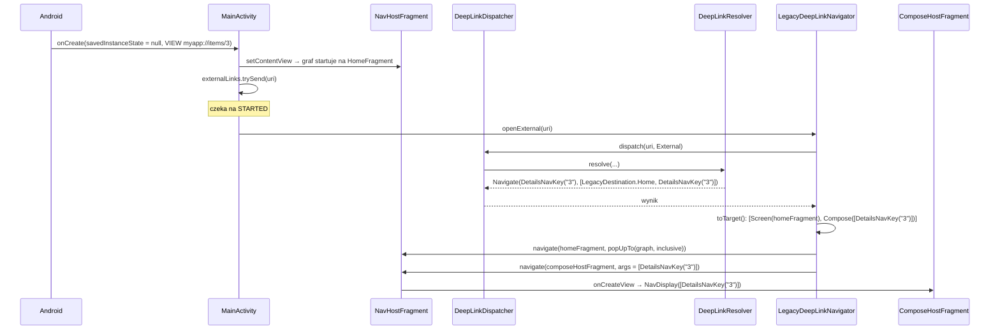
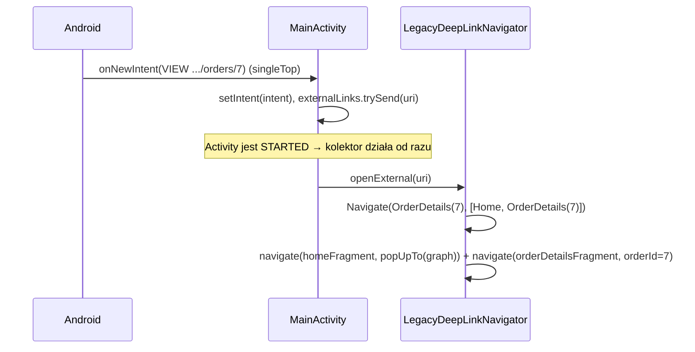
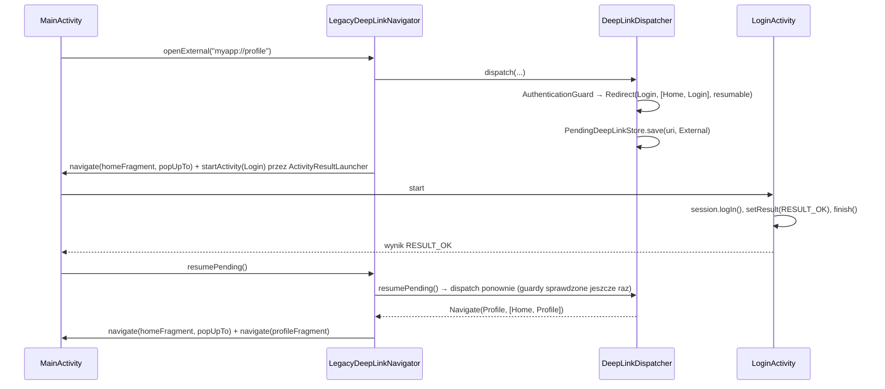
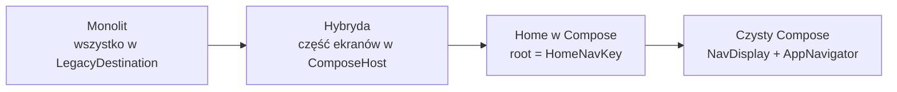

# Deeplinki w aplikacji z kodem legacy

Ten dokument opisuje, jak mechanizm deeplinków z [deeplinks.md](deeplinks.md) wpiąć w aplikację, która **jeszcze nie jest w pełni w Compose**: większość ekranów to Fragmenty z layoutami XML nawigowane przez `NavController` i `nav_graph.xml`, a tylko nowe feature'y powstają w Compose (Navigation 3).

Zakładam znajomość podstaw z [deeplinks.md](deeplinks.md) – resolvera, tras, guardów i `DeepLinkResult`. Tutaj opisuję tylko to, co **inne** w świecie legacy, i dlaczego.

---

## Spis treści

1. [Problem – czym legacy różni się od czystego Compose](#1-problem--czym-legacy-różni-się-od-czystego-compose)
2. [Główne decyzje](#2-główne-decyzje)
3. [Słownik pojęć](#3-słownik-pojęć)
4. [Struktura plików](#4-struktura-plików)
5. [Co dokładnie się dzieje – krok po kroku](#5-co-dokładnie-się-dzieje--krok-po-kroku)
6. [Elementy w szczegółach](#6-elementy-w-szczegółach)
7. [Bezpieczeństwo – gdzie legacy obchodzi guardy](#7-bezpieczeństwo--gdzie-legacy-obchodzi-guardy)
8. [Przykłady użycia](#8-przykłady-użycia)
9. [Migracja – od monolitu do czystego Compose](#9-migracja--od-monolitu-do-czystego-compose)
10. [Testowanie](#10-testowanie)
11. [Ograniczenia i TODO](#11-ograniczenia-i-todo)
12. [FAQ – „dlaczego nie…?”](#12-faq--dlaczego-nie)

---

## 1. Problem – czym legacy różni się od czystego Compose

W czystym Compose jest **jeden** back stack (`NavBackStack`) i **jeden** host (`NavDisplay`). W aplikacji z legacy kodem sytuacja wygląda tak:

| Cecha legacy | Konsekwencja dla deeplinków |
|---|---|
| Dwa systemy nawigacji: `NavController` (Fragmenty) i Nav3 (nowe ekrany) | Jeden link może prowadzić do Fragmentu, Activity albo ekranu Compose – trzeba wiedzieć, *jak* go pokazać. |
| `<deepLink>` w `nav_graph.xml` | `NavController` **sam** obsługuje Intent aktywności i otwiera ekran – z pominięciem jakiejkolwiek walidacji. |
| `<nav-graph>` w manifeście, stare Activity z własnymi `intent-filter` | Wiele wejść do aplikacji – każde trzeba zamknąć albo przepiąć na jeden pipeline. |
| Ekrany bez modułów (wszystko w `:app`) | Nie ma `:feature:*:api`, w którym mogłaby leżeć trasa. |
| Transakcje Fragmentów | Nawigacja po `onSaveInstanceState` kończy się wyjątkiem albo zgubioną transakcją. |
| Ekrany Compose muszą gdzieś „mieszkać” | Potrzebny jest Fragment, który hostuje `NavDisplay`. |
| Migracja ekran po ekranie | Publiczne URL-e (maile, push, web) **nie mogą się zmieniać**, gdy ekran zmienia technologię. |

Cel: **jeden pipeline dla wszystkich linków**, niezależnie od tego, w jakiej technologii jest ekran docelowy, i taki, który da się stopniowo „odchudzać” w trakcie migracji.

---

## 2. Główne decyzje

1. **`:core:deeplink` bez zmian.**
   Resolver zwraca `Destination` – abstrakcyjny cel. Nie wie, czy to Fragment, czy `NavKey`. To jest bezpośredni zysk z tego, że logika deeplinków nie ma zależności androidowych: zmienia się tylko warstwa wykonawcza w `:app`.

2. **Ekrany legacy dostają własne `Destination` i trasy w `:app`.**
   `LegacyDestination` + `LegacyDeepLinks` w jednym pliku. Trafiają do tego samego `Set<DeepLinkRoute>` co trasy feature'ów – więc działają guardy, limity, walidacja argumentów i wykrywanie konfliktów.

3. **Jedna tabela mapowania `Destination` → sposób pokazania.**
   `LegacyDeepLinkNavigator.toTarget()` to jedyne miejsce w aplikacji, które wie, że `Profile` to `R.id.profileFragment`, a `Login` to osobne Activity. Migracja ekranu = zmiana jednej linii.

4. **Ekrany Compose w `ComposeHostFragment`.**
   Jeden Fragment w `nav_graph.xml` hostuje `NavDisplay` z wpisami wszystkich feature'ów. Feature'y dostają zwykły `Navigator` i **nie wiedzą**, że działają we Fragmencie.

5. **Jedno wejście dla linków.**
   Usuwamy `<deepLink>` z grafu i `<nav-graph>` z manifestu. Wszystkie linki przechodzą przez `MainActivity` → `DeepLinkDispatcher` → resolver.

6. **Linki aplikowane tylko w stanie `STARTED`.**
   Kanał + `repeatOnLifecycle(STARTED)` zamiast nawigowania wprost w `onNewIntent`.

---

## 3. Słownik pojęć

| Pojęcie | Znaczenie |
|---|---|
| **`LegacyDestination`** | Cel nawigacji dla ekranu, który jeszcze żyje w monolicie (`Home`, `OrderDetails`, `Profile`, `Login`). Implementuje `Destination`, ale **nie** `NavKey`. |
| **`LegacyDeepLinks`** | Trasy (`deepLinkRoute(...)`) dla ekranów legacy. Odpowiednik `*DeepLinks` z modułów `:api`. |
| **`LegacyDeepLinkNavigator`** | Wykonawca `DeepLinkResult` nad `NavController` – odpowiednik `AppNavigator` z wersji Compose. |
| **`Target`** | Wewnętrzny opis „jak pokazać”: `Screen` (Fragment z grafu), `Compose` (klucze dla hosta), `Activity` (Intent). |
| **`ComposeHostFragment`** | Fragment hostujący `NavDisplay` – most między `NavController` a Navigation 3. |
| **`HostedNavigator`** | Implementacja `Navigator` dla feature'ów wewnątrz hosta: nawigacja w stosie Nav3, „wstecz” na korzeniu zdejmuje Fragment, linki idą do wspólnego pipeline'u. |
| **`DeepLinkHost`** | Interfejs implementowany przez `MainActivity`, przez który Fragmenty dostają się do `LegacyDeepLinkNavigator`. |

---

## 4. Struktura plików

```
project/
├── core/deeplink/                                ← BEZ ZMIAN (patrz deeplinks.md)
├── core/navigation/                              ← BEZ ZMIAN (Navigator, BackStackNavigator)
├── feature/
│   ├── details/{api,impl}                        ← nowe feature'y w Compose, BEZ ZMIAN
│   └── settings/{api,impl}
└── app/                                          ← MONOLIT
    ├── src/main/AndroidManifest.xml              jawne intent-filtry, singleTop, BEZ <nav-graph>
    ├── src/main/res/
    │   ├── navigation/nav_graph.xml              stary graf, BEZ <deepLink>
    │   ├── layout/fragment_*.xml, activity_*.xml layouty ekranów legacy
    │   └── values/ids.xml                        stałe id dla ComposeView (zapis stanu)
    └── src/main/kotlin/.../app/
        ├── MainActivity.kt                       NavHostFragment, odbiór linków, launcher logowania
        ├── legacy/                               ← „stary kod”
        │   ├── HomeFragment.kt                   ekran startowy (XML)
        │   ├── OrderDetailsFragment.kt           ekran z argumentem w Bundle
        │   ├── ProfileFragment.kt                ekran wymagający logowania
        │   ├── LoginActivity.kt                  logowanie w osobnej Activity
        │   ├── SessionManager.kt                 sesja (w symulacji: w pamięci)
        │   └── DeepLinkHost.kt                   dostęp Fragmentów do navigatora linków
        ├── compose/
        │   └── ComposeHostFragment.kt            NavDisplay we Fragmencie + HostedNavigator
        └── deeplink/
            ├── DeepLinkConfig.kt                 domeny + RootedBackStackPolicy(LegacyDestination.Home)
            ├── DeepLinkModule.kt                 resolver, PendingDeepLinkStore, guardy (bez zmian)
            ├── DeepLinkDispatcher.kt             Intent → URI, resolve, logi, odłożony link
            ├── LegacyDestinations.kt             ← NOWE: LegacyDestination + LegacyDeepLinks
            ├── LegacyDeepLinkModule.kt           ← NOWE: rejestracja tras legacy + AuthenticationGuard
            └── LegacyDeepLinkNavigator.kt        ← NOWE: Destination → Fragment / Activity / Compose
```

Zależności `:app` od feature'ów są takie same jak w wersji Compose (impl przez Hilt), plus moduły `:api` – bo ekrany legacy czasem nawigują do ekranu Compose po jego kluczu (patrz [8.4](#84-ekran-legacy-otwiera-ekran-compose)).

### Co się zmieniło względem wersji Compose

| Wersja Compose | Wersja legacy |
|---|---|
| `AppNavigator` nad `NavBackStack` | `LegacyDeepLinkNavigator` nad `NavController` |
| `SkeletonNavHost` z `NavDisplay` | `NavHostFragment` + `nav_graph.xml` |
| Trasy tylko w `:feature:*:api` | Dodatkowo `LegacyDeepLinks` w `:app` |
| Link z zimnego startu = początkowy back stack (`startBackStackFor`) | Link wykonywany po starcie grafu (`popUpTo(graph)` + `navigate`) |
| Wszystkie ekrany w jednym `NavDisplay` | Ekrany Compose w `ComposeHostFragment` |
| `DeepLinkDispatcher.startBackStackFor()`, `toNavKey()` | usunięte; dodane `discardPending()` |

---

## 5. Co dokładnie się dzieje – krok po kroku

### 5.1 Zimny start z linku do ekranu Compose

Aplikacja nie działa, użytkownik klika `myapp://items/3`.



Efekt: stos `NavController` = `[Home, ComposeHost]`, a wewnątrz hosta stos Nav3 = `[Details(3)]`. *Wstecz* z Details: stos Nav3 ma jeden element, więc `NavDisplay` nie przechwytuje gestu → `NavController` zdejmuje host → Home.

Dlaczego `popUpTo(graph, inclusive)`, skoro Home i tak jest na dole? Bo link z zewnątrz opisuje **cały** docelowy stan – przy ciepłym starcie na stosie może być cokolwiek (patrz 5.2). To odpowiednik `resetTo()` z wersji Compose.

### 5.2 Ciepły start – aplikacja już działa

Aplikacja jest otwarta np. na zamówieniu, przychodzi `https://app.example.com/orders/7`.



Dlaczego kanał, a nie `navigate` prosto w `onNewIntent`? `onNewIntent` przychodzi **przed** `onResume`, a Activity mogła być w tle po `onSaveInstanceState`. Transakcja Fragmentu w tym momencie to `IllegalStateException` (albo zgubiona zmiana przy `commitAllowingStateLoss`). `repeatOnLifecycle(STARTED)` gwarantuje, że link zostanie wykonany dopiero, gdy wolno modyfikować Fragmenty. `Channel.CONFLATED` – jeśli w tle przyjdą dwa linki, wykona się ostatni.

### 5.3 Link z wnętrza aplikacji – z ekranu legacy

Np. przycisk na `HomeFragment` z linkiem z backendu:

```kotlin
val result = deepLinks.openInApp(promo.link)            // ten sam pipeline co linki z zewnątrz
if (result == OpenLinkResult.Unsupported && promo.link.startsWith("https://")) {
    startActivity(Intent(Intent.ACTION_VIEW, Uri.parse(promo.link)))   // obcy link → przeglądarka
}
```

Dla `Source.InApp` navigator **nie przebudowuje stosu** – tylko dokłada cel na wierzch. *Wstecz* wraca tam, gdzie użytkownik był.

### 5.4 Link z wnętrza aplikacji – z ekranu Compose

Feature w Compose woła `navigator.openLink(uri)` – tak samo jak w czystej wersji. W hoście jest to `HostedNavigator`, który deleguje do `LegacyDeepLinkNavigator.openInApp()`. Dzięki temu feature może otworzyć ekran legacy (np. `myapp://orders/42`), nie wiedząc nic o Fragmentach.

### 5.5 Ekran wymagający logowania

`LegacyDestination.Profile` ma marker `RequiresAuthentication`. Użytkownik niezalogowany klika `myapp://profile`.



Anulowanie logowania (`RESULT_CANCELED`) → `discardPending()`: link jest zapominany, żeby nie „wyskoczył” przy następnym logowaniu z innego miejsca.

Dlaczego `ActivityResultLauncher`, a nie zwykłe `startActivity`? Bo `MainActivity` musi się dowiedzieć, **że** logowanie się udało. Launcher dostarcza wynik po powrocie do stanu `STARTED`, więc wznowienie linku może bezpiecznie robić transakcje Fragmentów.

### 5.6 Obrót ekranu i śmierć procesu

| Sytuacja | Co się dzieje |
|---|---|
| Obrót / zmiana konfiguracji | `savedInstanceState != null` → Intent **nie** jest przetwarzany ponownie. `NavController` odtwarza swój stos, `ComposeHostFragment` odtwarza stos Nav3 (`rememberNavBackStack` + stałe id `ComposeView`). |
| Śmierć procesu na ekranie Compose | `NavController` odtwarza Fragment hosta z jego argumentami; klucze startowe są w argumentach zserializowane (`NavKeySerializer`), więc host wstaje z tym samym ekranem. |
| Śmierć procesu w trakcie logowania | `PendingDeepLinkStore` jest tylko w pamięci → odłożony link przepada. To świadoma decyzja (patrz [deeplinks.md, 7.4](deeplinks.md#74-redirect-i-odłożony-link)). |

---

## 6. Elementy w szczegółach

### 6.1 `LegacyDestinations.kt` – cele i trasy ekranów legacy

```kotlin
internal sealed interface LegacyDestination : Destination {
    data object Home : LegacyDestination
    data class OrderDetails(val orderId: Long) : LegacyDestination
    data object Profile : LegacyDestination, RequiresAuthentication
    data object Login : LegacyDestination
}

internal object LegacyDeepLinks {
    val home = deepLinkRoute("home") { LegacyDestination.Home }
    val orderDetails = deepLinkRoute("orders/{orderId}") { params ->
        params.pathLong("orderId")?.let(LegacyDestination::OrderDetails)
    }
    val profile = deepLinkRoute("profile") { LegacyDestination.Profile }

    val all = setOf(home, orderDetails, profile)
}
```

- **Wszystko w jednym pliku** – celowo. To lista „długu”: każdy wpis to ekran do migracji. Gdy plik będzie pusty, migracja jest skończona.
- `Login` nie ma trasy – nie da się do niego wejść linkiem, jest tylko celem przekierowania.
- Markery (`RequiresAuthentication`, `InAppOnly`, `DebugOnly`) działają tak samo jak dla `NavKey` – guardy patrzą na `Destination`, nie na technologię ekranu.
- Typowane parametry (`pathLong`, `pathId`) – dla legacy szczególnie ważne, bo stare ekrany często wkładają argument prosto do zapytania SQL albo URL-a API.

### 6.2 `LegacyDeepLinkModule.kt` – rejestracja w Hilt

```kotlin
@Provides @ElementsIntoSet
fun provideLegacyRoutes(): Set<DeepLinkRoute> = LegacyDeepLinks.all

@Provides @IntoSet
fun provideAuthenticationGuard(session: SessionManager): DeepLinkGuard =
    AuthenticationGuard(isAuthenticated = session::isLoggedIn, loginDestination = LegacyDestination.Login)
```

`@ElementsIntoSet` dorzuca cały zbiór naraz. Trasy legacy i trasy z feature'ów lądują w jednym `Set<DeepLinkRoute>`, więc resolver przy starcie wykryje kolizję, jeśli ten sam wzorzec zadeklarują oba światy (patrz [9](#9-migracja--od-monolitu-do-czystego-compose)).

### 6.3 `LegacyDeepLinkNavigator.kt` – wykonawca

Trzy publiczne metody, analogiczne do `AppNavigator`:

| Metoda | Kto woła | Źródło |
|---|---|---|
| `openExternal(uri)` | `MainActivity` (zimny/ciepły start) | `External` |
| `openInApp(uri): OpenLinkResult` | Fragmenty, `HostedNavigator` | `InApp` |
| `resumePending(): Boolean` | `MainActivity` po udanym logowaniu | źródło zapisane z linkiem |

Sercem jest mapowanie:

```kotlin
private fun Destination.toTarget(): Target? = when (this) {
    LegacyDestination.Home -> Target.Screen(R.id.homeFragment)
    is LegacyDestination.OrderDetails -> Target.Screen(R.id.orderDetailsFragment, OrderDetailsFragment.args(orderId))
    LegacyDestination.Profile -> Target.Screen(R.id.profileFragment)
    LegacyDestination.Login -> Target.Activity(Intent(context, LoginActivity::class.java))
    is NavKey -> Target.Compose(listOf(this))      // klucze feature'ów = ekrany Compose
    else -> null                                    // nieznany cel → Unsupported, bez crasha
}
```

Kilka szczegółów, które mają znaczenie:

- **Najpierw mapowanie, potem nawigacja.** Jeśli którykolwiek element stosu nie ma mapowania, navigator zwraca `Unsupported` *zanim* cokolwiek zrobi. Nie zostaje pół-zbudowany stos.
- **Łączenie ekranów Compose** (`mergeCompose()`): kolejne `NavKey` w syntetycznym stosie trafiają do **jednego** hosta. Gdyby polityka zwróciła `[Home, Details, Settings]`, powstanie `[HomeFragment, ComposeHost([Details, Settings])]` – i *wstecz* między Details a Settings zostanie w Compose (z animacjami Nav3, zachowanym stanem itd.).
- **`popUpTo` tylko dla pierwszego elementu i tylko dla `External`.** Linki in-app tylko dokładają cel na wierzch.
- **Activity przez wstrzykniętą funkcję** (`startActivity: (Intent) -> Unit`) – navigator nie decyduje, *jak* uruchomić Activity. `MainActivity` przekazuje `activityLauncher::launch`, żeby dostać wynik logowania.

### 6.4 `ComposeHostFragment` – Navigation 3 we Fragmencie

```kotlin
@AndroidEntryPoint
class ComposeHostFragment : Fragment() {
    @Inject lateinit var entryProviderInstallers: Set<@JvmSuppressWildcards EntryProviderInstaller>

    override fun onCreateView(...): View {
        val startKeys = decodeFromSavedState(KEYS_SERIALIZER, requireArguments().getBundle(ARG_KEYS)!!)
        return ComposeView(requireContext()).apply {
            id = R.id.compose_host                       // stałe id → stan rememberSaveable jest zapisywany
            setContent {
                val backStack = rememberBackStackNavigator(startKeys)
                val navigator = remember(backStack) { HostedNavigator(backStack, navController, deepLinks) }
                NavDisplay(backStack = backStack.backStack, onBack = { navigator.goBack() }, ...)
            }
        }
    }

    companion object {
        fun args(keys: List<NavKey>): Bundle = bundleOf(ARG_KEYS to encodeToSavedState(KEYS_SERIALIZER, keys))
    }
}
```

- **Klucze w argumentach Fragmentu.** `NavKey` są `@Serializable`, więc `NavKeySerializer` z Nav3 + `encodeToSavedState` zamieniają je na `Bundle`. Argumenty Fragmentu przeżywają śmierć procesu – host zawsze wie, co pokazać.
- **Klucze startowe używane tylko raz.** Po pierwszym utworzeniu stos Nav3 odtwarza `rememberNavBackStack` – dokładnie jak w wersji Compose.
- **Stałe `id` dla `ComposeView`.** Stan `rememberSaveable` (w tym stos Nav3) jest zapisywany w hierarchii widoków według id. Bez stałego id po powrocie do hosta ze stosu `NavController` stan by przepadł.
- **Te same `EntryProviderInstaller` co w czystym Compose.** Feature'y nie wymagają żadnych zmian.

`HostedNavigator` – to, co widzą feature'y:

```kotlin
override fun navigate(key: NavKey) = backStack.navigate(key)                       // w obrębie Compose
override fun goBack(): Boolean = backStack.goBack() || navController.popBackStack() // korzeń → wyjście z hosta
override fun openLink(uri: String) = deepLinks.openInApp(uri)                      // wspólny pipeline
override fun resumePendingLink() = deepLinks.resumePending()
```

`goBack()` z `||` to cały „most” w drugą stronę: dopóki w stosie Nav3 jest więcej niż jeden ekran, cofamy w Compose; na ostatnim – zdejmujemy Fragment i wracamy do świata `NavController`. Systemowy gest *wstecz* zachowuje się tak samo: `NavDisplay` przechwytuje go tylko, gdy ma dokąd wrócić.

### 6.5 `MainActivity` – jedno wejście

```kotlin
private val externalLinks = Channel<String>(Channel.CONFLATED)

private val activityLauncher = registerForActivityResult(StartActivityForResult()) { result ->
    if (result.resultCode == RESULT_OK) deepLinks.resumePending() else deepLinkDispatcher.discardPending()
}

override fun onCreate(savedInstanceState: Bundle?) {
    super.onCreate(savedInstanceState)
    val navHost = supportFragmentManager.findFragmentById(R.id.nav_host) as NavHostFragment
    deepLinks = LegacyDeepLinkNavigator(this, navHost.navController, deepLinkDispatcher, activityLauncher::launch)

    if (savedInstanceState == null) deepLinkDispatcher.uriOf(intent)?.let(externalLinks::trySend)

    lifecycleScope.launch {
        repeatOnLifecycle(Lifecycle.State.STARTED) {
            externalLinks.receiveAsFlow().collect(deepLinks::openExternal)
        }
    }
}

override fun onNewIntent(intent: Intent) {
    super.onNewIntent(intent)
    setIntent(intent)
    deepLinkDispatcher.uriOf(intent)?.let(externalLinks::trySend)
}
```

- **`savedInstanceState == null`** – ta sama zasada co w wersji Compose: po odtworzeniu Activity stos odtwarza `NavController`, a Intent nie jest wykonywany drugi raz.
- **`uriOf(intent)`** – tylko `ACTION_VIEW` + `data`; extras są ignorowane.
- **`DeepLinkHost`** – `MainActivity` implementuje interfejs z właściwością `deepLinks`, a Fragmenty sięgają po nią przez rozszerzenie `Fragment.deepLinks`. To typowy wzorzec legacy; navigatora nie da się wziąć z Hilta, bo zależy od `NavController`, który istnieje dopiero po utworzeniu widoku.

### 6.6 `nav_graph.xml` i manifest

```xml
<!-- nav_graph.xml: celowo BEZ <deepLink> -->
<fragment android:id="@+id/orderDetailsFragment"
    android:name="...legacy.OrderDetailsFragment">
    <argument android:name="orderId" app:argType="long" />
</fragment>

<!-- host nowych ekranów -->
<fragment android:id="@+id/composeHostFragment"
    android:name="...compose.ComposeHostFragment" />
```

W manifeście: jawne `<intent-filter>` (https + własny schemat), `singleTop`, **bez** `<nav-graph>`. `LoginActivity` ma `exported="false"` – da się do niej wejść tylko z wnętrza aplikacji.

---

## 7. Bezpieczeństwo – gdzie legacy obchodzi guardy

Wszystkie warstwy z [deeplinks.md, rozdz. 7](deeplinks.md#7-bezpieczeństwo) działają bez zmian – ale **tylko dla tego, co przechodzi przez resolver**. W kodzie legacy jest kilka typowych „bocznych drzwi”:

| Boczne drzwi | Dlaczego groźne | Co zrobić |
|---|---|---|
| `<deepLink>` w `nav_graph.xml` | `NavHostFragment` przy ustawianiu grafu woła `handleDeepLink(activity.intent)` i sam otwiera ekran – bez guardów, limitów, walidacji ID. | Usunąć wszystkie `<deepLink>`. Trasę przenieść do `LegacyDeepLinks` (ten sam wzorzec). |
| `<nav-graph>` w manifeście | Generuje `intent-filter` z `<deepLink>` – nowe wejście, którego nikt nie widzi w manifeście źródłowym. | Usunąć, zastąpić jawnymi `<intent-filter>` na `MainActivity`. |
| Stare Activity z własnymi `intent-filter` | Każde to osobne, niewalidowane wejście. | Usunąć filtry; stary format URL obsłużyć trasą-aliasem (patrz [8.6](#86-stary-format-url--trasa-alias)). |
| Activity `exported="true"` bez filtrów | Każda aplikacja może je uruchomić z dowolnymi extras. | `exported="false"`, chyba że naprawdę musi być publiczne. |
| Bezpośrednie `navController.navigate(R.id.profileFragment)` | Guardy działają na linkach, nie na każdej nawigacji. | Do ekranów z markerami nawigować przez `openInApp("myapp://...")`, albo niech ekran sam sprawdza sesję. |
| Odczyt argumentów z `intent.extras` w starych ekranach | Extras to dane kontrolowane przez atakującego. | Argumenty tylko z typowanych tras (`pathLong`, `pathId`). |

Najprostszy test, czy drzwi są zamknięte: `adb shell dumpsys package <applicationId>` i sprawdzenie, że filtry `VIEW` ma tylko `MainActivity`.

---

## 8. Przykłady użycia

### 8.1 Deeplink do istniejącego ekranu legacy

Chcemy, żeby `myapp://orders/42/invoice` otwierał istniejący `InvoiceFragment`.

```kotlin
// LegacyDestinations.kt
data class Invoice(val orderId: Long) : LegacyDestination

val invoice = deepLinkRoute("orders/{orderId}/invoice") { params ->
    params.pathLong("orderId")?.let(LegacyDestination::Invoice)
}
val all = setOf(home, orderDetails, profile, invoice)
```

```kotlin
// LegacyDeepLinkNavigator.toTarget()
is LegacyDestination.Invoice -> Target.Screen(R.id.invoiceFragment, InvoiceFragment.args(orderId))
```

```kotlin
// DeepLinkContractTest – kontrakt publicznego URL-a
"myapp://orders/42/invoice" to listOf(LegacyDestination.Home, LegacyDestination.Invoice(42)),
```

Uwaga: `toTarget()` ma gałąź `else -> null`, więc kompilator **nie** wymusi nowej linii – cel bez mapowania skończy się `Unsupported`. Dlatego każdy nowy URL dostaje wpis w teście kontraktowym.

### 8.2 Ekran legacy wymagający logowania

Wystarczy marker:

```kotlin
data object Profile : LegacyDestination, RequiresAuthentication
```

`AuthenticationGuard` przekieruje na `LegacyDestination.Login`, a `MainActivity` wznowi link po `RESULT_OK`. Ekran sam w sobie nic nie robi.

### 8.3 Ekran Compose otwiera ekran legacy

Feature nie zna Fragmentów ani `R.id`. Używa linku:

```kotlin
entry<DetailsNavKey> { key ->
    DetailsRoute(onOrderClick = { orderId -> navigator.openLink("myapp://orders/$orderId") })
}
```

`HostedNavigator.openLink` → `LegacyDeepLinkNavigator.openInApp` → `OrderDetailsFragment` na wierzchu hosta. Gdy zamówienia zostaną przepisane na Compose, ten kod **się nie zmienia**.

### 8.4 Ekran legacy otwiera ekran Compose

Dwie opcje:

```kotlin
// A) po kluczu – typowane, wymaga zależności :app → :feature:details:api
navController.navigate(R.id.composeHostFragment, ComposeHostFragment.args(listOf(DetailsNavKey("3"))))

// B) po linku – bez zależności od klucza, przechodzi przez guardy
deepLinks.openInApp("myapp://items/3")
```

Rekomendacja: **B** dla ekranów z markerami (logowanie, `InAppOnly`) albo gdy cel może się jeszcze zmieniać; **A** dla prostych przejść, gdzie typowanie argumentów ma większą wartość.

### 8.5 Link z backendu na ekranie legacy

```kotlin
private fun openBackendLink(link: String) {
    val result = deepLinks.openInApp(link)
    if (result == OpenLinkResult.Unsupported && link.startsWith("https://")) {
        try {
            startActivity(Intent(Intent.ACTION_VIEW, Uri.parse(link)).addCategory(Intent.CATEGORY_BROWSABLE))
        } catch (_: ActivityNotFoundException) { }
    }
}
```

`Blocked` **nie** trafia do przeglądarki – guard odrzucił link, więc nigdzie go nie otwieramy.

### 8.6 Stary format URL – trasa-alias

Stara wersja aplikacji obsługiwała `myapp://order?id=42` (np. przez filtr na osobnej Activity), a te linki wciąż krążą w mailach. Zamiast zostawiać stare wejście:

```kotlin
/** Legacy format kept for links already sent out. Prefer orders/{orderId}. */
val orderLegacyAlias = deepLinkRoute("order") { params ->
    params.query("id")?.takeIf { it.matches(Regex("^[1-9][0-9]{0,18}$")) }?.toLongOrNull()
        ?.let(LegacyDestination::OrderDetails)
}
```

Stary URL przechodzi przez ten sam pipeline (limity, guardy, logi z redakcją), a stara Activity może stracić filtr.

---

## 9. Migracja – od monolitu do czystego Compose

### 9.1 Migracja jednego ekranu

Przykład: `OrderDetailsFragment` → `:feature:orders` w Compose.

**Krok 1.** Moduł `:feature:orders:api` – klucz i trasa z **tym samym wzorcem**:

```kotlin
@Serializable
data class OrderDetailsNavKey(val orderId: Long) : NavKey, Destination

object OrdersDeepLinks {
    val details = deepLinkRoute("orders/{orderId}") { params ->
        params.pathLong("orderId")?.let(::OrderDetailsNavKey)
    }
}
```

**Krok 2.** Moduł `:feature:orders:impl` – ekran, `EntryProviderInstaller`, rejestracja trasy (`@IntoSet`), jak w każdym feature'rze.

**Krok 3.** W `:app` usuń: `LegacyDestination.OrderDetails`, `LegacyDeepLinks.orderDetails`, linię w `toTarget()`, `OrderDetailsFragment` i wpis w `nav_graph.xml`. Klucz `OrderDetailsNavKey` trafia do gałęzi `is NavKey` → `ComposeHostFragment`.

**Krok 4.** Zaktualizuj test kontraktowy: ten sam URL, nowy cel.

```kotlin
"myapp://orders/42" to listOf(LegacyDestination.Home, OrderDetailsNavKey(42)),
```

Publiczny URL się nie zmienia. Wywołania `openLink("myapp://orders/…")` w innych feature'ach też nie.

**Bezpiecznik:** jeśli w kroku 3 zapomnisz usunąć starą trasę, resolver przy starcie rzuci:

```
Ambiguous deep link routes: orders/{orderId} vs orders/{orderId}
```

Oba wzorce mają ten sam *shape* (`["orders", null]`). Test kontraktowy wyłapie to w CI, zanim trafi na urządzenie.

### 9.2 Kolejność migracji



- **Ekran startowy na końcu.** Root polityki (`RootedBackStackPolicy(LegacyDestination.Home)`) to „kotwica” stosu. Gdy Home przejdzie do Compose, root zmienia się na `HomeNavKey` – w jednym miejscu (`DeepLinkConfig.kt`).
- **Logowanie może zostać w Activity dłużej** – to `Target.Activity`, niezależne od reszty.
- **Koniec migracji:** `LegacyDestinations.kt` jest pusty → usuwasz `LegacyDeepLinkNavigator`, `ComposeHostFragment`, `nav_graph.xml`; `MainActivity` przechodzi na `NavDisplay` + `AppNavigator` z wersji Compose (wraca też `startBackStackFor`). Trasy, guardy i testy kontraktowe zostają bez zmian.

---

## 10. Testowanie

### 10.1 Testy jednostkowe

`DeepLinkContractTest` składa resolver z **trasami legacy i feature'ów razem** – tak jak robi to Hilt:

```kotlin
private val resolver = createDeepLinkResolver(
    routes = LegacyDeepLinks.all + DetailsDeepLinks.item + SettingsDeepLinks.settings,
    guards = listOf(AuthenticationGuard(isAuthenticated = { loggedIn }, loginDestination = LegacyDestination.Login)),
)
```

Sprawdza:
- publiczne URL-e → oczekiwany stos (mieszanka `LegacyDestination` i `NavKey`),
- przekierowanie na logowanie dla `Profile`,
- ścisłą walidację ID (`orders/abc`, `orders/-1`, `orders/007`, przepełnienie `Long`, traversal w `items/...`).

```bash
./gradlew test
```

### 10.2 Na urządzeniu (adb)

```bash
# zimny start → ekran Compose, wstecz → Home (XML)
adb shell am force-stop <applicationId>
adb shell am start -a android.intent.action.VIEW -d "myapp://items/3" <applicationId>

# ekran legacy z argumentem
adb shell am start -a android.intent.action.VIEW -d "https://app.example.com/orders/42" <applicationId>

# guard: bez sesji → logowanie → po zalogowaniu profil
adb shell am start -a android.intent.action.VIEW -d "myapp://profile" <applicationId>

# odrzucone
adb shell am start -a android.intent.action.VIEW -d "myapp://orders/abc" <applicationId>        # NotMatched
adb shell am start -a android.intent.action.VIEW -d "myapp://items/..%2Fadmin" <applicationId>  # Invalid

# logi
adb logcat -s DeepLink
```

### 10.3 Lista kontrolna ręcznych testów

| Scenariusz | Oczekiwany wynik |
|---|---|
| Zimny start z linkiem do Compose | Ekran Compose, *wstecz* → Home |
| XML → Compose, strzałka wstecz w Compose | Host zdjęty, powrót do XML |
| XML → link → Compose → *wstecz* ×2 | Compose → XML → Home |
| Ekran z guardem bez sesji (z zewnątrz i z aplikacji) | Logowanie → po `OK` cel; po *Anuluj* link zapomniany |
| Link z backendu do naszej domeny | Ekran w aplikacji |
| Obcy link `https` | Przeglądarka |
| Ciepły start (aplikacja otwarta) | `onNewIntent` → cel, *wstecz* → Home |
| Śmierć procesu na ekranie Compose (`adb shell am kill` w tle) | Po powrocie ten sam ekran |
| Obrót na ekranie legacy i Compose | Stan zachowany, link nie wykonuje się ponownie |

---

## 11. Ograniczenia i TODO

| Temat | Stan | Co zrobić |
|---|---|---|
| Link in-app do Compose, gdy już jesteśmy w hoście | Otwiera **nowy** `ComposeHostFragment` na wierzchu | Jeśli bieżący cel to host – dołożyć klucz do jego stosu Nav3 zamiast tworzyć nowy Fragment |
| Krótkie utworzenie `HomeFragment` przy zimnym starcie | Zwykle niewidoczne (zastępowany przed pierwszą klatką) | Jeśli przeszkadza: zdjąć `app:navGraph` z layoutu i przed `setGraph` ustawić `startDestination` z linku |
| `Target.Activity` w środku syntetycznego stosu | Działa tylko sensownie jako ostatni element | Polityka back stacku nie powinna stawiać Activity pod innymi ekranami |
| Dwa stosy (`NavController` + Nav3 w hoście) | Celowe na czas migracji | Znika po przejściu na czysty Compose |
| Bezpośrednie `navController.navigate` do ekranów z markerami | Omija guardy | Nawigować przez `openInApp` albo sprawdzać sesję w samym ekranie |
| `SessionManager` | Fałszywy, w pamięci | Podpiąć prawdziwą sesję |
| Build release na urządzeniu | Nieprzetestowany | Sprawdzić R8 z `NavKeySerializer` (serializacja kluczy w argumentach) |

---

## 12. FAQ – „dlaczego nie…?”

**Dlaczego nie zostawić `<deepLink>` w `nav_graph.xml`? To przecież działa.**
Działa – i właśnie dlatego jest groźne. `NavController` otwiera ekran sam, zanim nasz kod zdąży cokolwiek sprawdzić: nie ma guardów, limitów wejścia, typowanej walidacji argumentów ani logów z redakcją. Do tego dopasowanie wzorców i budowa back stacku (z hierarchii grafów) są poza naszą kontrolą.

**Dlaczego nie `NavDeepLinkBuilder` / `TaskStackBuilder` do syntetycznego stosu?**
Budują stos na podstawie struktury grafu (rodzice → start destination), a nie naszej `BackStackPolicy`. Nie znają też ekranów Compose w hoście ani Activity logowania. `popUpTo` + seria `navigate` daje dokładnie ten stos, który zwrócił resolver.

**Dlaczego trasy legacy w `:app`, a nie od razu w modułach?**
Bo ekrany legacy nie mają modułów. Tworzenie `:api` tylko dla trasy wymusiłoby też przeniesienie klucza, a klucz legacy (`R.id` + `Bundle`) nie pasuje do modelu `NavKey`. Jeden plik w `:app` to świadomy, widoczny dług – przenosi się go razem z migracją ekranu.

**Dlaczego jeden `ComposeHostFragment` dla wszystkich feature'ów, a nie Fragment na feature?**
Bo wtedy nawigacja *między* ekranami Compose zostaje w Nav3 (animacje, `ViewModel` per wpis, zapis stanu), a feature'y nie muszą wiedzieć o Fragmentach. Nowy feature nie wymaga zmian w `nav_graph.xml` – wystarczy `EntryProviderInstaller`.

**Dlaczego `Navigator` nie jest wstrzykiwany przez Hilt (np. `@ActivityRetainedScoped`) i podpinany do stosu?**
Stos Nav3 żyje w kompozycji (`rememberNavBackStack` – zapis stanu, śmierć procesu), a `NavController` w hierarchii Fragmentów. Obiekt z DI żyje dłużej niż oba – musiałby je „podpinać” i „odpinać”, a każde okno między tymi momentami to nawigacja do martwego stosu. `HostedNavigator` jest tworzony razem ze stosem, który obsługuje, więc tego problemu nie ma.

**Dlaczego `DeepLinkHost` (rzutowanie Activity), a nie DI?**
`LegacyDeepLinkNavigator` potrzebuje `NavController`, który istnieje dopiero po utworzeniu `NavHostFragment`. Hilt nie ma takiego zakresu. Interfejs na Activity jest jawny, prosty i znika razem z migracją.

**Dlaczego wznowienie linku po logowaniu przez `ActivityResultLauncher`?**
Bo to jedyny niezawodny sposób, żeby `MainActivity` wiedziała, że logowanie **się udało**, i dostała tę informację w stanie, w którym wolno robić transakcje Fragmentów. Anulowanie jest równie ważne – czyści odłożony link.
