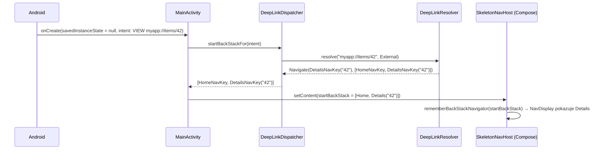
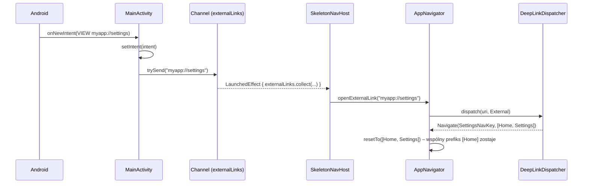
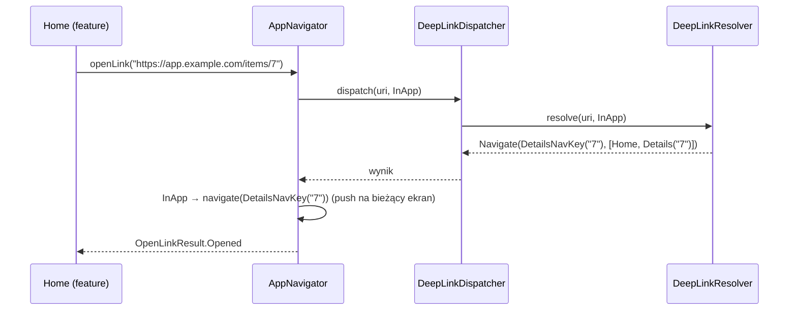

# Deeplinki – mechanizm nawigacji z linków

Ten dokument opisuje, jak działają deeplinki w projekcie: **po co powstał ten mechanizm, co dokładnie dzieje się od kliknięcia linku do pokazania ekranu, jak jest zabezpieczony, jak wygląda struktura kodu i jak go używać**.

---

## Spis treści

1. [Po co to wszystko? (problem)](#1-po-co-to-wszystko-problem)
2. [Główne decyzje projektowe](#2-główne-decyzje-projektowe)
3. [Słownik pojęć](#3-słownik-pojęć)
4. [Struktura modułów i plików](#4-struktura-modułów-i-plików)
5. [Co dokładnie się dzieje – krok po kroku](#5-co-dokładnie-się-dzieje--krok-po-kroku)
6. [Elementy mechanizmu w szczegółach](#6-elementy-mechanizmu-w-szczegółach)
7. [Bezpieczeństwo](#7-bezpieczeństwo)
8. [Przykłady użycia](#8-przykłady-użycia)
9. [Testowanie](#9-testowanie)
10. [Ograniczenia i TODO](#10-ograniczenia-i-todo)
11. [FAQ – „dlaczego nie…?”](#11-faq--dlaczego-nie)

---

## 1. Po co to wszystko? (problem)

Deeplink to URL, który otwiera **konkretny ekran** aplikacji, np.:

```
myapp://items/42
https://app.example.com/items/42
```

Brzmi prosto, ale w praktyce trzeba odpowiedzieć na sporo pytań:

| Pytanie | Dlaczego to problem |
|---|---|
| Który ekran pasuje do URL-a? | Kilka wzorców może pasować do jednego linku (`items/new` vs `items/{id}`). |
| Skąd wziąć argumenty? | `42` trzeba wyciągnąć z URL-a, **zwalidować** i włożyć do klucza nawigacji. |
| Co jest „pod spodem”? | Po wejściu z linku na Details przycisk *wstecz* powinien prowadzić do Home, a nie zamykać aplikację. |
| Czy wolno tam wejść? | Deeplink to **niezaufane dane z zewnątrz** – każda aplikacja może wysłać taki Intent. |
| Co gdy aplikacja już działa? | Link przychodzi wtedy do `onNewIntent`, a nie do `onCreate`. |
| Co po obrocie ekranu / śmierci procesu? | Activity ma wciąż ten sam Intent – łatwo przetworzyć link **drugi raz**. |
| A link, który przyszedł z backendu? | Powinien przejść tę samą drogę (walidacja, guardy), ale otworzyć się „na wierzchu” bieżącego ekranu. |
| Jak to przetestować? | Logika rozsiana po Activity i Compose wymaga emulatora; powinna dać się sprawdzić zwykłym testem jednostkowym. |

Navigation 3 (1.2.0) ma wbudowane API deeplinków (`androidx.navigation3.runtime.deeplink`), ale to **tylko parser/matcher** URI → `NavKey`. Nie obsługuje Intentów, back stacku ani bezpieczeństwa, a dodatkowo wiąże format URL-a z nazwami pól w kluczu (przez `kotlinx.serialization`). Dlatego powstała własna, cienka warstwa opisana niżej.

---

## 2. Główne decyzje projektowe

1. **Logika jest platformowo-neutralna.**
   Moduł `core:deeplink` to czysty Kotlin – bez Androida, Compose, Nav3 i nawet bez `java.*`. Nie zawiera żadnych zależności androidowych, dzięki czemu jest w pełni testowalny zwykłymi testami jednostkowymi (bez emulatora i Robolectrica) i nie jest związany z żadną platformą ani biblioteką nawigacji.

2. **Resolver nie nawiguje – zwraca decyzję.**
   `DeepLinkResolver.resolve(uri, source)` zwraca `Navigate`, `Redirect`, `Rejected`, `NotMatched` albo `Invalid`. Wykonaniem decyzji zajmuje się adapter platformowy (na Androidzie: Navigation 3 + Compose).

3. **Ścieżki są w modułach feature'ów** (obok klucza nawigacji), a **domeny/schematy w `:app`**.
   Feature wie tylko „jestem pod `items/{itemId}`”, nie wie nic o `https://app.example.com` ani `myapp://`.

4. **Jawne mapowanie URL → klucz** z typowaną walidacją (`pathId`, `pathLong`).
   Zmiana nazwy pola w kluczu nie zepsuje po cichu publicznego linku, a śmieci z URL-a nie trafią do zapytań API.

5. **Jedna, centralna polityka back stacku** (`BackStackPolicy` w `:app`).
   Feature'y nie muszą się znać, żeby opisać „co jest pod spodem”.

6. **Security by default** – limity wejścia, wykrywanie path traversal i znaków sterujących, guardy z priorytetami, redakcja logów, ignorowanie extras z Intentu. Szczegóły w [rozdziale 7](#7-bezpieczeństwo).

7. **Jedna droga dla wszystkich linków.** Link z zewnątrz (Intent) i link z wnętrza aplikacji (np. z backendu) przechodzą przez ten sam resolver i te same guardy. Różni je tylko `DeepLinkSource` i sposób pokazania wyniku.

8. **Deterministyczność i szybkie błędy** – ranking tras i kolejność guardów są jawne; niejednoznaczne trasy wywalają aplikację już przy starcie.

---

## 3. Słownik pojęć

| Pojęcie | Co to jest | Gdzie |
|---|---|---|
| `DeepLink` | Sparsowany URI: `scheme`, `host`, `pathSegments`, `queryParameters`. | `core:deeplink` |
| `Destination` | Platformowo-neutralny „cel nawigacji”. Interfejs-znacznik. | `core:deeplink` |
| `DeepLinkSource` | Skąd przyszedł link: `External` (system/inna aplikacja) albo `InApp` (kod aplikacji, np. link z backendu). | `core:deeplink` |
| `DeepLinkOrigin` | Jakie linki przyjmujemy: `Web(host)` lub `CustomScheme(scheme)`. Zamienia `DeepLink` na listę segmentów ścieżki. | `core:deeplink`, konfiguracja w `:app` |
| `DeepLinkLimits` | Twarde limity wejścia (długość, liczba segmentów/parametrów, długość wartości). | `core:deeplink` |
| `DeepLinkRoute` | Wzorzec ścieżki (`items/{itemId}`) + funkcja tworząca `Destination`. | definicja w `feature:*:api` |
| `DeepLinkParams` | Argumenty dla fabryki: `path`, `pathId`, `pathLong`, `query`. | `core:deeplink` |
| `BackStackPolicy` | Buduje syntetyczny back stack dla celu. | `core:deeplink`, wybór w `:app` |
| `DeepLinkGuard` | Decyduje, czy wolno otworzyć cel: `Allow` / `Reject` / `Redirect`. Ma `priority`. | `core:deeplink`, rejestracja w `:app` |
| `DeepLinkRequest` | To, co widzi guard: `destination`, `source`, `origin`. | `core:deeplink` |
| Markery | `RequiresAuthentication`, `InAppOnly`, `DebugOnly` – wymagania deklarowane na kluczu. | `core:deeplink`, używane w `feature:*:api` |
| `PendingDeepLinkStore` | Pamięta link przerwany przez `Redirect` (np. do logowania), żeby go potem wznowić. | `core:deeplink` |
| `DeepLinkResolver` | Składa wszystko: URI + źródło → `DeepLinkResult`. | `core:deeplink` |
| `DeepLinkResult` | `Navigate` / `Redirect` / `Rejected` / `NotMatched` / `Invalid`. | `core:deeplink` |
| `DeepLinkDispatcher` | Adapter Androida: Intent → URI, wywołanie resolvera, bezpieczne logi, zapis odłożonego linku. | `:app` |
| `Navigator` | API dla feature'ów: `navigate`, `goBack`, `resetTo`, **`openLink`**, **`resumePendingLink`**. | `core:navigation` |
| `AppNavigator` | Implementacja `Navigator` w `:app` – wykonuje wyniki resolvera na back stacku. | `:app` |
| `NavKey` | Klucz nawigacji Navigation 3. Nasze klucze implementują **jednocześnie** `NavKey` i `Destination`. | `feature:*:api` |

---

## 4. Struktura modułów i plików

### Zależności między modułami

```
                        ┌──────────────────────┐
                        │        :app          │  konfiguracja (domeny, polityka, guardy),
                        │                      │  adapter Android/Compose (Dispatcher, AppNavigator)
                        └──────────┬───────────┘
              ┌────────────────────┼─────────────────────┐
              ▼                    ▼                     ▼
   :feature:home:impl    :feature:details:impl   :feature:settings:impl   rejestrują trasy (@IntoSet),
              │                    │                     │                 używają Navigator.openLink
              ▼                    ▼                     ▼
   :feature:home:api     :feature:details:api    :feature:settings:api    NavKey + DeepLinkRoute (+ markery)
              └────────────────────┼─────────────────────┘
                     ┌─────────────┴─────────────┐
                     ▼                           ▼
             :core:navigation              :core:deeplink                 czysty Kotlin, bez Androida
             (Nav3, Navigator)
```

`core:deeplink` **nie zależy od niczego** – ani od Androida, ani od Compose, ani od Navigation 3. Cała logika deeplinków (łącznie z zabezpieczeniami) jest więc testowalna na JVM i niezależna od platformy.

### Pliki

```
project/
├── core/
│   ├── deeplink/                                  ← LOGIKA DEEPLINKÓW (czysty Kotlin)
│   │   └── src/
│   │       ├── main/kotlin/.../core/deeplink/
│   │       │   ├── DeepLink.kt                    parser URI + percent-decoding (UTF-8)
│   │       │   ├── Destination.kt                 interfejs celu nawigacji
│   │       │   ├── DestinationRequirements.kt     markery: RequiresAuthentication / InAppOnly / DebugOnly
│   │       │   ├── DeepLinkSource.kt              External / InApp
│   │       │   ├── DeepLinkOrigin.kt              Web / CustomScheme
│   │       │   ├── DeepLinkLimits.kt              limity wejścia + walidacja (traversal, znaki sterujące)
│   │       │   ├── DeepLinkRoute.kt               wzorzec, dopasowanie, ranking, DeepLinkParams
│   │       │   ├── BackStackPolicy.kt             BackStackPolicy + RootedBackStackPolicy
│   │       │   ├── DeepLinkGuard.kt               guard, Decision, DeepLinkRequest, GuardPriority
│   │       │   ├── Guards.kt                      DebugOnlyGuard / InAppOnlyGuard / AuthenticationGuard
│   │       │   ├── PendingDeepLinkStore.kt        odłożony link (TTL, jednorazowy, tylko w pamięci)
│   │       │   ├── Redaction.kt                   redactDeepLink() – bezpieczna forma do logów
│   │       │   └── DeepLinkResolver.kt            resolver + DeepLinkResult
│   │       └── test/kotlin/.../core/deeplink/     testy parsera, resolvera, guardów, store'a, redakcji
│   │
│   └── navigation/src/main/kotlin/.../core/navigation/
│       ├── Navigator.kt                           API dla feature'ów + OpenLinkResult
│       └── BackStackNavigator.kt                  operacje na NavBackStack + rememberBackStackNavigator()
│
├── feature/
│   └── details/
│       ├── api/src/main/kotlin/.../feature/details/api/
│       │   ├── DetailsNavKey.kt                   data class DetailsNavKey(...) : NavKey, Destination
│       │   └── DetailsDeepLinks.kt                ← TU są ścieżki tego feature'a
│       └── impl/src/main/kotlin/.../feature/details/impl/navigation/
│           └── DetailsDeepLinkModule.kt           @Provides @IntoSet → rejestracja trasy
│   (home i settings – analogicznie; home/impl pokazuje też openLink() dla linku z backendu)
│
└── app/
    ├── src/main/AndroidManifest.xml               intent-filtry (https + własny schemat), singleTop
    ├── src/main/kotlin/.../app/
    │   ├── MainActivity.kt                        onCreate (zimny start) + onNewIntent (ciepły)
    │   ├── navigation/
    │   │   ├── SkeletonNavHost.kt                 NavDisplay + odbiór linków z onNewIntent
    │   │   └── AppNavigator.kt                    Navigator: wykonuje DeepLinkResult (External/InApp)
    │   └── deeplink/
    │       ├── DeepLinkConfig.kt                  DEEP_LINK_ORIGINS + createDeepLinkResolver()
    │       ├── DeepLinkModule.kt                  Hilt: trasy + guardy → resolver, PendingDeepLinkStore
    │       └── DeepLinkDispatcher.kt              Intent → URI, resolve, logi, odłożony link
    └── src/test/kotlin/.../app/deeplink/
        └── DeepLinkContractTest.kt                kontrakt: publiczny URL → oczekiwany back stack
```

---

## 5. Co dokładnie się dzieje – krok po kroku

### 5.1 Start aplikacji – składanie resolvera (Hilt)

Zanim przyjdzie jakikolwiek link, Hilt składa `DeepLinkResolver`:

1. Każdy `feature:*:impl` ma moduł Hilt, który dorzuca swoją trasę do wspólnego zbioru:
   ```kotlin
   @Provides @IntoSet
   fun provideItemDeepLink(): DeepLinkRoute = DetailsDeepLinks.item
   ```
2. `:app` (`DeepLinkModule`) rejestruje guardy (`DebugOnlyGuard`, `InAppOnlyGuard`) i wstrzykuje `Set<DeepLinkRoute>` + `Set<DeepLinkGuard>` do `createDeepLinkResolver(routes, guards)`.
3. `createDeepLinkResolver` dokłada konfigurację aplikacji: `DEEP_LINK_ORIGINS` i `RootedBackStackPolicy(root = HomeNavKey)`.
4. Konstruktor `DeepLinkResolver`:
   - sortuje trasy wg **specyficzności** ([6.5](#65-deeplinkroute--wzorzec-ranking-i-walidacja-argumentów)),
   - sortuje guardy wg **priorytetu** ([7.3](#73-guardy)),
   - **sprawdza niejednoznaczności** – jeśli dwie trasy mają ten sam kształt (`items/{id}` i `items/{itemId}`), rzuca `IllegalArgumentException`.

`:app` nie zna żadnej ścieżki – dostaje je z feature'ów przez multibinding (tak samo jak ekrany przez `EntryProviderInstaller`).

### 5.2 Zimny start z linku

Aplikacja nie działa, użytkownik klika `myapp://items/42`.



- Link staje się **początkowym** back stackiem – nie ma sekwencji „pokaż Home → przejdź na Details”, więc nie ma mignięcia.
- Gdy Intent nie jest deeplinkiem (start z ikony – akcja `MAIN`) albo link jest odrzucony/niepoprawny, startujemy z `listOf(HomeNavKey)`.
- Gdy guard zwróci `Redirect` (np. do logowania), początkowym stosem jest stos przekierowania, a oryginalny link trafia do `PendingDeepLinkStore`.

### 5.3 Ciepły start – aplikacja już działa

Aplikacja jest otwarta na Home (lista przewinięta w dół), przychodzi `myapp://settings`. Dzięki `android:launchMode="singleTop"` Android **nie tworzy nowej Activity**, tylko woła `onNewIntent`.



`resetTo` **zachowuje wspólny prefiks** stosu: Home zostaje nietknięty – razem z ViewModelem i pozycją przewinięcia. `Channel(CONFLATED)` – przy kilku linkach naraz liczy się ostatni.

### 5.4 Link z wnętrza aplikacji (np. z backendu)

Na Home jest baner, którego treść i link przychodzą z backendu: `https://app.example.com/items/7`. Użytkownik go klika.



Różnica względem linku z zewnątrz:

| | `External` (Intent) | `InApp` (`navigator.openLink`) |
|---|---|---|
| Walidacja, limity, guardy | tak | **tak, te same** |
| Co dzieje się z back stackiem | `resetTo(syntetyczny stos)` | `navigate(cel)` – na wierzch bieżącego ekranu |
| *Wstecz* prowadzi do | elementu ze stosu syntetycznego (Home) | ekranu, z którego kliknięto link |
| Cele `InAppOnly` | odrzucone | dozwolone |

### 5.5 Obrót ekranu / śmierć procesu – dlaczego link nie wykona się dwa razy

Po obrocie ekranu Activity jest tworzona od nowa i **`getIntent()` nadal zawiera ten sam link**. Gdybyśmy w `onCreate` robili `navigate(...)`, po każdym obrocie użytkownik dostałby kolejną kopię ekranu.

U nas:

1. `onCreate` przetwarza Intent **tylko gdy `savedInstanceState == null`** – przy odtworzeniu nie ma ani nawigacji, ani ponownego zapisu odłożonego linku.
2. `rememberBackStackNavigator(startBackStack)` używa `rememberNavBackStack` (`rememberSaveable`): przy pierwszym utworzeniu bierze `startBackStack`, przy odtworzeniu przywraca zapisany stos.

Link jest *początkowym stanem*, a nie *akcją*.

### 5.6 Co dzieje się wewnątrz `resolve(uri, source)`

Przykład: `https://app.example.com/items/42?utm_source=mail`, źródło `External`.

```
1. Limity surowego URI
   długość ≤ 2048, brak znaków sterujących / spacji / bidi        → inaczej Invalid
2. DeepLink.parse(uri)
   → scheme="https", host="app.example.com", path=["items","42"], query={utm_source=mail}
   (null → Invalid("Malformed URI"))
3. Limity po zdekodowaniu
   ≤ 16 segmentów, ≤ 32 parametry, każda wartość ≤ 256 znaków,
   żaden segment nie jest "." / ".." ani nie zawiera "/" lub "\" (np. z %2F), brak znaków sterujących
                                                                  → inaczej Invalid
4. Origins – pierwszy pasujący daje segmenty ścieżki:
   Web("app.example.com") → ["items","42"]                       (żaden → NotMatched)
5. Trasy (wg specyficzności) – pierwsza, która zwróci Destination:
   "items/{itemId}" → pathId("itemId") = "42" → DetailsNavKey("42") (żadna → NotMatched)
6. Guardy (wg priorytetu) – DeepLinkRequest(destination, source, origin):
   pierwszy Reject → Rejected, pierwszy Redirect → Redirect, wszystkie Allow → dalej
7. BackStackPolicy:
   → Navigate(DetailsNavKey("42"), [HomeNavKey, DetailsNavKey("42")])
```

---

## 6. Elementy mechanizmu w szczegółach

### 6.1 `DeepLink` – parser URI

Plik: `core/deeplink/.../DeepLink.kt`. Napisany ręcznie (zamiast `android.net.Uri` / `java.net.URI`), żeby moduł nie miał zależności platformowych, a parser był testowalny bez Androida.

| Wejście | Wynik |
|---|---|
| `https://user@Example.com:443/items/42/?ref=a&ref=b#top` | scheme `https`, host `Example.com`, path `[items, 42]`, query `{ref=a}` |
| `MYAPP://items/42` | scheme `myapp` (schemat zawsze małymi literami), host `items`, path `[42]` |
| `myapp:items/42` | host `null`, path `[items, 42]` |
| `https://a.b/za%C5%BC%C3%B3%C5%82%C4%87` | path `[zażółć]` (dekodowanie UTF-8) |
| `?q=a+b%26c` | `q = "a b&c"` (`+` → spacja tylko w query) |
| `no-scheme/items`, `https://a.b/%zz` | `null` (niepoprawny URI) |

Puste segmenty są pomijane, fragment `#...` ignorowany, przy powtórzonym parametrze query wygrywa pierwszy.

### 6.2 `DeepLinkSource` – skąd przyszedł link

```kotlin
enum class DeepLinkSource { External, InApp }
```

- `External` – z systemu, przeglądarki, innej aplikacji. **W pełni niezaufany.**
- `InApp` – otwarty przez kod aplikacji (`navigator.openLink`), np. link z backendu. **Też walidowany** – treść może pochodzić od innego użytkownika (czat, profil) albo ze skompromitowanego API.

Źródło wpływa na guardy (np. `InAppOnlyGuard`) i na sposób pokazania wyniku ([5.4](#54-link-z-wnętrza-aplikacji-np-z-backendu)).

### 6.3 `DeepLinkOrigin` – jakie linki przyjmujemy

Konfiguracja: `app/.../deeplink/DeepLinkConfig.kt`

```kotlin
internal val DEEP_LINK_ORIGINS = listOf(
    DeepLinkOrigin.Web(host = "app.example.com"),   // https://app.example.com/<ścieżka>
    DeepLinkOrigin.CustomScheme(scheme = "myapp"),  // myapp://<ścieżka>
)
```

Dzięki temu **ta sama trasa `items/{itemId}` obsługuje oba formaty** i feature nie wie nic o domenie.

- `Web` – tylko `https` (domyślnie; `http` jest odrzucany) i dokładnie ten host.
- `CustomScheme` – w `myapp://items/42` parser widzi `items` jako *host*, więc origin dokleja go jako pierwszy segment ścieżki.

### 6.4 `Destination`, klucze i markery

```kotlin
@Serializable
data class DetailsNavKey(val itemId: String) : NavKey, Destination
```

- `NavKey` – potrzebny Navigation 3 na Androidzie,
- `Destination` – potrzebny platformowo-neutralnej logice z `core:deeplink`.

Feature może dodatkowo **zadeklarować wymagania** markerami (egzekwują je guardy w `:app`):

```kotlin
data class OrderNavKey(val orderId: Long) : NavKey, Destination, RequiresAuthentication
data class PaymentNavKey(val id: String) : NavKey, Destination, InAppOnly
data object DevMenuNavKey : NavKey, Destination, DebugOnly
```

### 6.5 `DeepLinkRoute` – wzorzec, ranking i walidacja argumentów

```kotlin
val item: DeepLinkRoute = deepLinkRoute("items/{itemId}") { params ->
    params.pathId("itemId")?.let { DetailsNavKey(itemId = it) }
}
```

**Reguły wzorca:** segmenty oddzielone `/`; `{nazwa}` musi być **całym segmentem** (`items/item_{id}` → błąd); nazwy placeholderów nie mogą się powtarzać; literały porównywane z rozróżnieniem wielkości liter; liczba segmentów musi się zgadzać dokładnie; query nie jest częścią wzorca.

**Argumenty – `DeepLinkParams`:**

| Metoda | Zwraca | Kiedy używać |
|---|---|---|
| `pathId(name)` | wartość, jeśli pasuje do `[A-Za-z0-9_-]{1,64}`, inaczej `null` | **domyślnie** dla identyfikatorów |
| `pathLong(name)` | dodatnia liczba bez znaku, zer wiodących itp., inaczej `null` | numeryczne ID |
| `path(name)` | surowa (zdekodowana) wartość | tylko gdy naprawdę potrzebny dowolny tekst – i wtedy waliduj sam |
| `query(name)` | wartość parametru lub `null` | opcjonalne parametry |

**Fabryka zwraca `null`** → trasa jest traktowana jak niepasująca (`NotMatched`).

**Ranking:** porównujemy segmenty od lewej; na pierwszej różnicy **literał wygrywa z placeholderem** (`items/new` przed `items/{id}`). Kolejność rejestracji nie ma znaczenia. Dwie trasy o tym samym kształcie → wyjątek przy starcie.

### 6.6 `BackStackPolicy` – syntetyczny back stack

```kotlin
class RootedBackStackPolicy(private val root: Destination) : BackStackPolicy {
    override fun backStackFor(destination: Destination) =
        if (destination == root) listOf(root) else listOf(root, destination)
}
```

| Cel | Stos |
|---|---|
| `HomeNavKey` | `[Home]` |
| `DetailsNavKey("42")` | `[Home, Details("42")]` |
| `SettingsNavKey` | `[Home, Settings]` |

**Dlaczego centralnie?** Gdyby `details:api` samo deklarowało „pode mną jest Home”, musiałoby zależeć od `home:api` – feature'y zaczęłyby się znać.

### 6.7 `DeepLinkResolver` i `DeepLinkResult`

```kotlin
sealed interface DeepLinkResult {
    data class Navigate(val destination: Destination, val backStack: List<Destination>)
    data class Redirect(val destination: Destination, val backStack: List<Destination>, val resumable: Boolean)
    data class Rejected(val destination: Destination, val reason: String)
    data object NotMatched                       // nie nasz link albo brak trasy
    data class Invalid(val reason: String)       // zepsute/podejrzane wejście
}
```

- Resolver to **czysta funkcja**: ten sam URI + źródło → zawsze ten sam wynik.
- Wyniki **celowo nie zawierają URI** – mógłby zawierać sekrety, a wyniki lubią trafiać do logów.
- `Navigate` i `Redirect` niosą i cel, i stos – adapter wybiera, czego użyć, zależnie od źródła.

### 6.8 Adapter Androida – `DeepLinkDispatcher` i `AppNavigator`

**`DeepLinkDispatcher`** (`app/.../deeplink/DeepLinkDispatcher.kt`, `@Singleton`):

1. `uriOf(intent)` – tylko `ACTION_VIEW` + `data`; **extras są ignorowane**,
2. `dispatch(uri, source)` – resolver + bezpieczny log + zapis odłożonego linku przy `Redirect(resumable = true)`,
3. `startBackStackFor(intent)` – zimny start,
4. `resumePending()` – pobiera odłożony link i dispatchuje go ponownie.

**`AppNavigator`** (`app/.../navigation/AppNavigator.kt`) – implementacja `Navigator`, którą dostają feature'y:

| Wynik | `External` | `InApp` | `OpenLinkResult` |
|---|---|---|---|
| `Navigate` | `resetTo(backStack)` | `navigate(destination)` (bez duplikatu, jeśli już na wierzchu) | `Opened` |
| `Redirect` | `resetTo(backStack)` | `navigate(destination)` | `Opened` |
| `Rejected` | nic | nic | `Blocked` |
| `NotMatched` / `Invalid` | nic | nic | `Unsupported` |

### 6.9 Elementy Compose

| Element | Rola |
|---|---|
| `MainActivity.onCreate` | gdy `savedInstanceState == null`: link z Intentu → `startBackStack` |
| `MainActivity.onNewIntent` | URI → `Channel` |
| `SkeletonNavHost` | tworzy `AppNavigator`; `LaunchedEffect { externalLinks.collect(navigator::openExternalLink) }` |
| `rememberBackStackNavigator(startBackStack)` | używa stosu startowego tylko przy pierwszym utworzeniu |
| `BackStackNavigator.resetTo(keys)` | podmienia stos, zachowując wspólny prefiks |
| `AndroidManifest.xml` | `singleTop` + `intent-filter` dla `https://app.example.com` i `myapp://` |

---

## 7. Bezpieczeństwo

### 7.1 Model zagrożeń

- **Każda aplikacja na telefonie może wysłać dowolny URI** do naszej eksportowanej Activity – także `https://app.example.com/...` i także jawnym Intentem, z pominięciem przeglądarki.
- **Zweryfikowane App Links nie są uwierzytelnieniem źródła.** Weryfikacja domeny decyduje tylko o tym, że system *kieruje* kliknięte linki do nas; nie gwarantuje, że link przyszedł z naszej strony. `getReferrer()` da się podrobić.
- **Linki z backendu też mogą być wrogie** – treści tworzone przez użytkowników, przejęte API.
- **Deeplink nie jest autoryzacją.** O tym, czy użytkownik może zobaczyć zamówienie 42, decyduje backend.

Wniosek: każdy link jest niezaufany; różne źródła mogą mieć różne uprawnienia, ale żadne nie omija walidacji.

### 7.2 Warstwy obrony

| # | Warstwa | Co blokuje | Gdzie |
|---|---|---|---|
| 1 | Intent-filtry w manifeście | inne schematy i hosty w ogóle nie trafiają do aplikacji | `AndroidManifest.xml` |
| 2 | Tylko `ACTION_VIEW` + `data`, **bez extras** | przemycanie danych w extras Intentu | `DeepLinkDispatcher.uriOf` |
| 3 | Limity surowego URI | bardzo długie URI, znaki sterujące, spacje, znaki bidi (podszywanie się pod inny tekst) | `DeepLinkLimits` |
| 4 | Parser | zepsute `%XX`, brak schematu | `DeepLink.parse` |
| 5 | Limity po dekodowaniu | path traversal (`..`, `%2F`, `%5C`), `%00`, `%0A`, za dużo segmentów/parametrów, za długie wartości | `DeepLinkLimits` |
| 6 | Origins | obce domeny, `http`, inne schematy | `DeepLinkOrigin` |
| 7 | Typowane argumenty | wstrzyknięcia w ID (`' OR 1=1`, `a.b`, `-1`, `007`) | `pathId` / `pathLong` |
| 8 | Guardy | debug-ekrany w release, ekrany tylko-z-aplikacji otwierane z zewnątrz, brak logowania | `DeepLinkGuard` |
| 9 | Redakcja logów | wyciek tokenów/PII do logcata | `redactDeepLink` + `BuildConfig.DEBUG` |
| 10 | Odłożony link: TTL, jednorazowy, tylko w pamięci, ponowna walidacja | wznowienie starego/podmienionego linku po logowaniu | `PendingDeepLinkStore` |
| 11 | Brak ponownego przetworzenia Intentu | duplikacja akcji po obrocie/śmierci procesu | `MainActivity.onCreate` |

### 7.3 Guardy

```kotlin
fun interface DeepLinkGuard {
    fun check(request: DeepLinkRequest): Decision
    val priority: Int get() = GuardPriority.DEFAULT

    sealed interface Decision {
        data object Allow : Decision
        data class Reject(val reason: String) : Decision
        data class Redirect(val destination: Destination, val resumeAfter: Boolean = true) : Decision
    }
}

data class DeepLinkRequest(val destination: Destination, val source: DeepLinkSource, val origin: DeepLinkOrigin)
```

**Kolejność** – rosnąco wg `priority`, pierwsza decyzja inna niż `Allow` wygrywa. Remis rozstrzyga nazwa klasy (Hilt `Set` nie ma kolejności, więc sortujemy jawnie).

| Stała `GuardPriority` | Wartość | Przeznaczenie |
|---|---|---|
| `KILL_SWITCH` | 0 | zdalne wyłączenie trasy/celu |
| `DEBUG` | 100 | ekrany deweloperskie |
| `APP_LOCK` | 200 | PIN / biometria |
| `ONBOARDING` | 300 | zgody, wymuszona aktualizacja |
| `AUTHENTICATION` | 400 | logowanie |
| `SOURCE` | 500 | reguły zależne od źródła |
| `ARGUMENTS` | 600 | dodatkowa walidacja argumentów |
| `DEFAULT` | 1000 | pozostałe |

**Gotowe guardy** (`core/deeplink/.../Guards.kt`):

| Guard | Reguła | Zarejestrowany |
|---|---|---|
| `DebugOnlyGuard(isDebugBuild)` | cel `DebugOnly` w release → `Reject` | tak (`BuildConfig.DEBUG`) |
| `InAppOnlyGuard()` | cel `InAppOnly` ze źródła innego niż `InApp` → `Reject` | tak |
| `AuthenticationGuard(isAuthenticated, loginDestination)` | cel `RequiresAuthentication` bez sesji → `Redirect(login)` | nie – wymaga sesji i ekranu logowania ([8.5](#85-logowanie-i-wznowienie-linku)) |

### 7.4 Redirect i odłożony link

Przepływ „zaloguj się i wróć”:

```
myapp://orders/42 (RequiresAuthentication), brak sesji
 → AuthenticationGuard: Redirect(LoginNavKey)
 → Dispatcher: zapis "myapp://orders/42" w PendingDeepLinkStore
 → pokazany ekran logowania
 ... użytkownik się loguje ...
 → ekran logowania: navigator.resumePendingLink()
 → Dispatcher: consume() + ponowne resolve() – guardy sprawdzają link jeszcze raz, już z sesją
 → Navigate(OrderNavKey(42))
```

Właściwości `PendingDeepLinkStore`: **tylko w pamięci** (nie przeżyje śmierci procesu – celowo), **jednorazowy**, **TTL 5 minut**, przechowuje **surowe URI**, a nie wynik – więc guardy zawsze decydują na aktualnym stanie.

### 7.5 Logi

- Debug: pełne URI (wygodne przy pracy).
- Release: `redactDeepLink(uri)` – schemat i host zostają, każdy segment ścieżki to `*`, query i fragment znikają:
  `https://app.example.com/reset/abc123?email=x` → `https://app.example.com/*/*?…`
- Dla odrzuconych celów logowana jest tylko **nazwa klasy** celu, nigdy jego argumenty.

### 7.6 Reguły dla autorów feature'ów

1. **Ekran otwarty z linku nie wykonuje akcji.** Żadnych płatności, usuwania, akceptowania zaproszeń w `init` ViewModelu – użytkownik zawsze klika potwierdzenie.
2. **ID zawsze przez `pathId` / `pathLong`.** `path()` tylko świadomie, z własną walidacją.
3. **Nie przenoś sekretów w `NavKey`.** Klucze są zapisywane w saved state (na dysk przy śmierci procesu). Token z linku (reset hasła, magic link) wymień od razu na serwerze, a na stosie trzymaj tylko wynik.
4. **Oznacz wymagania markerem** (`RequiresAuthentication`, `InAppOnly`, `DebugOnly`) zamiast pisać własny guard dla jednego ekranu.
5. **`OpenLinkResult.Blocked` nie otwieraj nigdzie indziej.** Fallback do przeglądarki tylko dla `Unsupported` i tylko dla `https://`.
6. **Uprawnienia sprawdza backend.** Deeplink tylko pokazuje ekran.

---

## 8. Przykłady użycia

### 8.1 Nowy deeplink do istniejącego feature'a

Chcemy, żeby `myapp://item/42` (stary format linków z maili) też otwierał Details.

**Krok 1** – trasa w `feature/details/api/.../DetailsDeepLinks.kt`:

```kotlin
/** Legacy: `myapp://item/42` */
val legacyItem: DeepLinkRoute = deepLinkRoute("item/{itemId}") { params ->
    params.pathId("itemId")?.let { DetailsNavKey(itemId = it) }
}
```

**Krok 2** – rejestracja w `feature/details/impl/.../navigation/DetailsDeepLinkModule.kt`:

```kotlin
@Provides
@IntoSet
fun provideLegacyItemDeepLink(): DeepLinkRoute = DetailsDeepLinks.legacyItem
```

**Krok 3** – przypadek w `DeepLinkContractTest`:

```kotlin
"myapp://item/42" to listOf(HomeNavKey, DetailsNavKey("42")),
```

Manifestu nie trzeba ruszać – intent-filtry łapią cały schemat i cały host.

### 8.2 Nowy feature z deeplinkiem (z parametrem query)

Hipotetyczny feature `search`, otwierany linkiem `myapp://search?q=kot`.

```kotlin
// feature/search/api/.../SearchNavKey.kt
@Serializable
data class SearchNavKey(val query: String = "") : NavKey, Destination

// feature/search/api/.../SearchDeepLinks.kt
object SearchDeepLinks {
    /** `myapp://search?q=kot`, `https://<host>/search?q=kot` */
    val search: DeepLinkRoute = deepLinkRoute("search") { params ->
        SearchNavKey(query = params.query("q").orEmpty().take(100))
    }
}

// feature/search/impl/.../navigation/SearchDeepLinkModule.kt
@Module
@InstallIn(SingletonComponent::class)
internal object SearchDeepLinkModule {
    @Provides @IntoSet
    fun provideSearchDeepLink(): DeepLinkRoute = SearchDeepLinks.search
}
```

Plus standardowo: `SearchEntryProvider`, wpisy w `settings.gradle.kts` i `implementation(projects.feature.search.impl)` w `app/build.gradle.kts`. **Kod deeplinków w `:app` się nie zmienia.**

### 8.3 Otwieranie linku z backendu w feature'rze

Tak działa baner na Home (`feature/home/impl/.../navigation/HomeEntryProvider.kt`):

```kotlin
entry<HomeNavKey> {
    val uriHandler = LocalUriHandler.current
    HomeRoute(
        onPromoClick = { promo ->
            // Ta sama walidacja i guardy co dla linków z zewnątrz.
            val result = navigator.openLink(promo.link)
            // Nie nasz link → przeglądarka, ale tylko https (nigdy intent://, file://, javascript: ...).
            // Blocked NIE jest otwierany nigdzie indziej.
            if (result == OpenLinkResult.Unsupported && promo.link.startsWith("https://")) {
                uriHandler.openUri(promo.link)
            }
        },
        // ...
    )
}
```

Ten sam wzorzec obsłuży link z powiadomienia push (gdy aplikacja jest otwarta), z WebView czy z kodu QR – wszystko przez `navigator.openLink(uri)`.

### 8.4 Ekran dostępny tylko z wnętrza aplikacji

```kotlin
@Serializable
data class PaymentNavKey(val paymentId: String) : NavKey, Destination, InAppOnly

val payment = deepLinkRoute("payments/{paymentId}") { p -> p.pathId("paymentId")?.let(::PaymentNavKey) }
```

- `myapp://payments/abc` z zewnątrz → `Rejected` (log: `Rejected PaymentNavKey: Destination can be opened only from within the app`),
- `navigator.openLink("myapp://payments/abc")` z aplikacji → otwiera ekran.

### 8.5 Logowanie i wznowienie linku

Gdy w aplikacji pojawi się sesja i ekran logowania:

```kotlin
// :app – DeepLinkModule
@Provides @IntoSet
fun provideAuthenticationGuard(session: SessionRepository): DeepLinkGuard =
    AuthenticationGuard(isAuthenticated = session::isLoggedIn, loginDestination = LoginNavKey)

// feature:orders:api
data class OrderNavKey(val orderId: Long) : NavKey, Destination, RequiresAuthentication

// feature:login:impl – po udanym logowaniu
if (!navigator.resumePendingLink()) {
    navigator.goBack()   // nie było odłożonego linku (albo wygasł) – zwykły powrót
}
```

### 8.6 Własny guard – kill switch

```kotlin
internal class KillSwitchGuard @Inject constructor(
    private val remoteConfig: RemoteConfig,
) : DeepLinkGuard {
    override val priority = GuardPriority.KILL_SWITCH

    override fun check(request: DeepLinkRequest): DeepLinkGuard.Decision {
        val disabled = remoteConfig.getStringSet("disabled_deeplink_destinations")
        return if (request.destination::class.simpleName in disabled) {
            DeepLinkGuard.Decision.Reject("Disabled remotely")
        } else {
            DeepLinkGuard.Decision.Allow
        }
    }
}

@Module
@InstallIn(SingletonComponent::class)
internal interface KillSwitchModule {
    @Binds @IntoSet
    fun bindKillSwitchGuard(impl: KillSwitchGuard): DeepLinkGuard
}
```

> Przy włączonym R8 nazwy klas są zaciemniane – w produkcji lepiej porównywać stały identyfikator (np. dodatkowe pole/marker w kluczu) niż `simpleName`.

### 8.7 Inna polityka back stacku

```kotlin
// app/.../deeplink/DeepLinkConfig.kt
private val APP_BACK_STACK_POLICY = BackStackPolicy { destination ->
    when (destination) {
        HomeNavKey -> listOf(HomeNavKey)
        is DetailsNavKey -> listOf(HomeNavKey, SearchNavKey(), destination)
        else -> listOf(HomeNavKey, destination)
    }
}
```

i podmień `RootedBackStackPolicy(root = HomeNavKey)` w `createDeepLinkResolver`.

---

## 9. Testowanie

### 9.1 Testy jednostkowe

```bash
./gradlew :core:deeplink:test          # parser, limity, traversal, ranking, guardy, Redirect, TTL, redakcja
./gradlew :app:testDebugUnitTest       # DeepLinkContractTest – publiczne URL-e i walidacja ID
```

`DeepLinkContractTest` traktuje publiczne URL-e jak **kontrakt** – linki z maili i pushy żyją latami, więc zmiana tego, co otwierają, musi być świadoma.

> Test kontraktu podaje listę tras ręcznie. Jeśli zapomnisz zarejestrować trasy w Hilt (`@IntoSet`), test tego nie wykryje.

### 9.2 Na urządzeniu (adb)

```bash
ADB=~/Library/Android/sdk/platform-tools/adb

# zimny start
$ADB shell am force-stop <applicationId>
$ADB shell am start -a android.intent.action.VIEW -d "myapp://items/3"

# ciepły start (aplikacja otwarta) → onNewIntent
$ADB shell am start -a android.intent.action.VIEW -d "myapp://settings"

# podejrzane wejście → Invalid
$ADB shell am start -a android.intent.action.VIEW -d "'myapp://items/..%2F..%2Fadmin'"
$ADB shell am start -a android.intent.action.VIEW -d "'myapp://items/a%00b'"

# extras są ignorowane
$ADB shell am start -a android.intent.action.VIEW -d "myapp://items/4" --es token SECRET

# logi
$ADB logcat -d -s DeepLink
```

| Scenariusz | Oczekiwany efekt |
|---|---|
| zimny start `items/3` | od razu Details „Item #3”; *wstecz* → Home |
| ciepły `settings` przy przewiniętej liście | Settings; *wstecz* → Home z zachowaną pozycją listy |
| obrót ekranu po deeplinku | ten sam ekran, **brak** zdublowanego wpisu |
| kliknięcie banera na Home | Details „Item #7” na wierzchu; *wstecz* → Home; log `Opening (InApp)` |
| `items/..%2F..%2Fadmin` | brak zmiany ekranu; `Invalid link: Path traversal attempt` |
| `items/a%00b` | brak zmiany ekranu; `Invalid link: Control characters in decoded value` |
| `nope` | brak zmiany ekranu; `Unsupported link` |

### 9.3 Bez adb, z telefonu

- `https://app.example.com/...` – domena nie jest zweryfikowana (brak `assetlinks.json`), więc Android 12+ otworzy przeglądarkę. Obejście: *Ustawienia → Aplikacje → (aplikacja) → Otwórz domyślnie → Dodaj link*.
- `myapp://...` – wpisany w pasek adresu Chrome nie zadziała; musi być **kliknięty** jako link na stronie.

---

## 10. Ograniczenia i TODO

| Temat | Stan | Co zrobić |
|---|---|---|
| Domena `app.example.com` | placeholder | podmienić na własną w `DeepLinkConfig.kt` i w manifeście |
| App Links (weryfikacja) | brak | `android:autoVerify="true"` + `/.well-known/assetlinks.json` |
| Manifest ↔ `DEEP_LINK_ORIGINS` | ręczna synchronizacja | test/lint sprawdzający zgodność |
| `AuthenticationGuard` | gotowy, niezarejestrowany | zarejestrować, gdy powstanie sesja i ekran logowania |
| Kill switch, app lock, onboarding | brak | guardy wg [8.6](#86-własny-guard--kill-switch) i priorytetów z [7.3](#73-guardy) |
| Fallback do przeglądarki | wzorzec w jednym feature'rze | wynieść do wspólnego helpera, gdy pojawi się w kolejnych miejscach |
| Wzorce | tylko całe segmenty, bez wildcardów | dodać, jeśli będzie potrzeba |
| Zapomniana rejestracja `@IntoSet` | nie wykrywana testem kontraktu | test instrumentalny z Hilt sprawdzający `Set<DeepLinkRoute>` |
| `launchMode` | `singleTop` | link kliknięty w innej aplikacji otwiera nową instancję Activity w zadaniu *tamtej* aplikacji; rozważyć `singleTask` |

---

## 11. FAQ – „dlaczego nie…?”

**Dlaczego nie wbudowane deeplinki Navigation 3?**
Nav3 1.2.0 daje parser/matcher URI → `NavKey`, ale wzorce byłyby w kodzie zależnym od Nav3 (logika deeplinków przestałaby być platformowo-neutralna), argumenty mapowane są przez `kotlinx.serialization` po nazwach pól, ranking ma remisy zależne od kolejności, a back stack, Intenty, `onNewIntent` i bezpieczeństwo i tak trzeba napisać samemu.

**Dlaczego nie `android.net.Uri`?**
Bo `core:deeplink` ma nie mieć zależności androidowych – testy działają na czystym JVM. Parser ma ok. 90 linii i jest pokryty testami.

**Dlaczego `resetTo` dla linków z zewnątrz, a `navigate` dla linków z aplikacji?**
Link z zewnątrz opisuje *cały docelowy stan* – użytkownik przychodzi spoza aplikacji. Link w aplikacji to krok dalej z miejsca, w którym użytkownik jest – *wstecz* powinno go tam zwrócić.

**Dlaczego resolver nie nawiguje sam?**
Musiałby znać `Navigator` / Nav3 / Compose. Zwracając wynik, zostaje czystą funkcją: łatwą do testowania i niezależną od platformy.

**Dlaczego wynik nie zawiera URI?**
URI może zawierać tokeny lub dane osobowe, a wyniki łatwo trafiają do logów i crash reportów.

**Dlaczego odłożony link nie jest zapisywany na dysk?**
Bo po śmierci procesu kontekst („użytkownik właśnie kliknął link i się loguje”) już nie istnieje. Wznowienie starego linku dużo później byłoby zaskakujące i potencjalnie niebezpieczne.

**Dlaczego `Channel`, a nie `mutableStateOf` w Activity?**
Deeplink to *zdarzenie* (wykonaj raz), a nie *stan*. `Channel` dostarcza je dokładnie raz do `LaunchedEffect`.

**Dlaczego trasy w `:api`, a nie w `:impl`?**
Ścieżka URL to publiczny kontrakt feature'a – leży obok klucza. `:api` jest lekkie (bez Compose i Hilt); `:impl` tylko rejestruje trasę.
