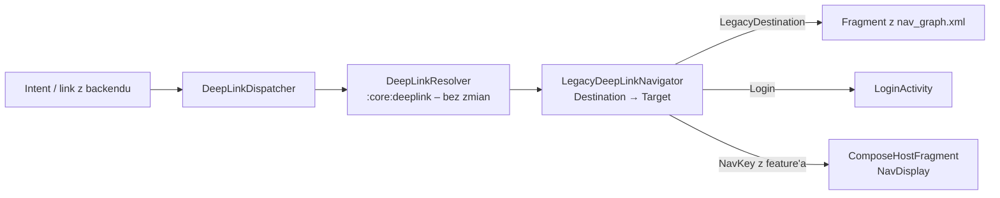

# Deep linki w starym monolicie (symulacja)

Branch `legacy-sim` symuluje projekt, w którym większość ekranów to jeszcze Fragmenty w `:app`
nawigowane przez `NavController` i `nav_graph.xml`, a tylko nowe feature'y są w Compose (Navigation 3).

Główna teza: **`:core:deeplink` nie zmienia się ani o linijkę.** Resolver zwraca `Destination`,
a dopiero warstwa wykonawcza w `:app` wie, czy to Fragment, Activity, czy ekran Compose.

## Co się zmienia względem wersji Compose

| Wersja Compose (`feature/deeplinks`) | Monolit (`legacy-sim`) |
|---|---|
| `AppNavigator` nad `NavBackStack` | `LegacyDeepLinkNavigator` nad `NavController` |
| `SkeletonNavHost` z `NavDisplay` | `NavHostFragment` + `nav_graph.xml` |
| Trasy tylko w `:feature:*:api` | Dodatkowo `LegacyDeepLinks` w `:app` dla ekranów bez modułu |
| `startBackStackFor()` – link jako początkowy stos | Link wykonywany po starcie (`popUpTo(graph)` + `navigate`) |
| Wszystkie ekrany w jednym `NavDisplay` | Ekrany Compose w `ComposeHostFragment` (Nav3 wewnątrz Fragmentu) |

`DeepLinkDispatcher` stracił tylko `startBackStackFor()`/`toNavKey()` (były specyficzne dla Nav3)
i zyskał `discardPending()` (anulowane logowanie).

## Przepływ



## Kluczowe elementy

- **`LegacyDestination` + `LegacyDeepLinks`** (`app/.../deeplink/LegacyDestinations.kt`)
  – cele i trasy ekranów, które nie mają jeszcze modułu `:api`. Trafiają do tego samego
  `Set<DeepLinkRoute>` co trasy feature'ów, więc działa wykrywanie konfliktów, guardy i limity.
- **`LegacyDeepLinkNavigator.toTarget()`** – jedyna tabela mapowania `Destination` → Fragment /
  Activity / Compose. Kolejne ekrany Compose w syntetycznym stosie są łączone w jeden host,
  żeby „wstecz” między nimi zostawało w Compose.
- **`ComposeHostFragment`** – `NavDisplay` wewnątrz Fragmentu. Klucze startowe przychodzą
  w argumentach (`NavKeySerializer` + `encodeToSavedState`), więc przeżywają śmierć procesu.
  Feature'y dostają zwykły `Navigator`: „wstecz” na ostatnim ekranie Compose zdejmuje Fragment,
  a `openLink()` idzie przez wspólny pipeline.
- **Logowanie** – `AuthenticationGuard` przekierowuje na `LoginActivity`, uruchamiane przez
  `ActivityResultLauncher`. `RESULT_OK` → `resumePending()`, anulowanie → `discardPending()`.

## Pułapki starego kodu (usunięte w symulacji)

1. **`<deepLink>` w `nav_graph.xml`** – `NavController` sam obsłużyłby Intent i otworzył ekran
   z pominięciem resolvera (bez guardów, limitów i walidacji ID).
2. **`<nav-graph>` w manifeście** – generuje intent filtry z tych `<deepLink>`. Zamiast tego
   jawne `<intent-filter>`.
3. **Inne Activity z własnymi intent filtrami** – każde wejście ma iść przez `MainActivity`.
4. **Nawigacja po `onSaveInstanceState`** – linki są aplikowane w `repeatOnLifecycle(STARTED)`,
   nie wprost w `onNewIntent`.
5. **Ponowne przetworzenie Intentu po odtworzeniu Activity** – `savedInstanceState == null`,
   tak jak w wersji Compose.

## Migracja jednego ekranu

Przykład: `OrderDetailsFragment` → `:feature:orders` w Compose.

1. W `:feature:orders:api`: `OrderDetailsNavKey(orderId) : NavKey, Destination` i trasa
   `orders/{orderId}` – **ten sam wzorzec**.
2. Usuń `LegacyDestination.OrderDetails`, jego trasę i linię w `toTarget()`. Klucz trafia
   do gałęzi `is NavKey` → `ComposeHostFragment`.
3. Publiczny URL się nie zmienia. Zapomniana stara trasa = wyjątek
   `Ambiguous deep link routes` przy starcie (test kontraktowy złapie to w CI).

Gdy `LegacyDestination` jest pusty, `:app` przechodzi na `NavDisplay` + `AppNavigator`
z branchu `feature/deeplinks`. Trasy, guardy i testy zostają.

## Jak przetestować

```bash
adb shell am start -a android.intent.action.VIEW -d "myapp://items/3"     <applicationId>  # Compose, wstecz → Home (XML)
adb shell am start -a android.intent.action.VIEW -d "myapp://orders/42"   <applicationId>  # Fragment
adb shell am start -a android.intent.action.VIEW -d "myapp://profile"     <applicationId>  # logowanie → po nim profil
adb shell am start -a android.intent.action.VIEW -d "myapp://orders/abc"  <applicationId>  # odrzucony (Unsupported)
```

Na ekranie Home są przyciski do przejść XML → XML, XML → Compose, linku in-app z guardem,
linku „z backendu” i obcego linku (fallback do przeglądarki).
